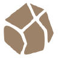

# Element basic attacks: base form (tiles 16 → 128)

Each element animal has one basic attack whose shape follows from what the animal does: the dragon breathes, the bird beats its wings, the turtle hides in a thorny shell, the orca hunts by echolocation, the snake spits venom, the unicorn’s horn draws lightning, the lion picks off the weak, and the ox stomps. Every element has a distinct role, and between them they cover all four ranges and all four targeting types. Fusions build on these later.

A rendered version with range diagrams is in [Element basic attacks.html](Element%20basic%20attacks.html).

## The table

| | Element | Attack | Range | Targets | Effect | Why it fits the animal | Weak at | Grows 16 → 128 |
|---|---|---|---|---|---|---|---|---|
|  | **Fire** Baby dragon *Brawler* | **Ember Breath** Cone up its lane, widening to half a lane each side | Short 2 cells (cone) | Area all in cone | Burn: damage over time, stacks up to 3 | A dragon breathes fire, and a baby’s small lungs only reach a short way. Fire clings to whatever it touches, so foes keep burning after the breath ends. | Short reach: it only hits foes that are already close. | A longer breath (2 → 3 cells); the burn cap stays at 3 stacks. |
|  | **Wind** Bird *Controller* | **Wing Gust** A gust that rushes up the entire lane | Long whole lane | Line all in lane | Knockback: pushes every foe in the lane 0.5 cell back (bosses 0.25) | A wingbeat makes a gust that shoves everything in its path. Wind moves things more than it hurts them, so damage is low and control is high. | Low damage: it delays foes far more than it kills them. | Push 0.5 → 1 cell; at 128 the gust also catches the neighbouring lanes. A foe pushed in the last 1.5 s slides only 40% as far. |
|  | **Nature** Turtle *Guardian* | **Bramble Shell** A thorny ring that pulses around the tile | Melee 1 cell around its tile | Area all within 1 cell | Root 0.6 s, plus thorns that return 25% of damage taken; each pulse that hits regrows 3% HP on itself and adjacent blocks | Turtles don’t chase anything. They pull into a shell that hurts to bite, vines hold the attacker in place, and the mossy shell slowly grows back. | No range: useless until foes reach the board. | Ring radius 1 → 1.5 cells; regrow 3 → 6%; thorns 25 → 40%. |
|  | **Ice** Orca *Hunter* | **Echo Harpoon** A sonar ping marks the toughest foe, then an ice harpoon strikes it | Long whole lane | Single 1 (toughest) | Chill: slows 35% for 2 s; every 4th harpoon on the same target freezes it for 1 s | Orcas find big prey by echolocation, so the ping always locks onto the toughest foe. A pod wears its prey down and then corners it, which is why repeated hits end in a freeze. | One target at a time, and slow. | Freeze every 4th → 3rd hit; slow 35 → 45%; from 64 the ping also covers neighbouring lanes. |
|  | **Poison** Snake *Saboteur* | **Venom Spit** A glob that lands on the path and leaves a puddle for 3 s | Mid 3 cells | Area glob: 1 cell; puddle: all in it | Poison stacks while a foe stands in the puddle (up to 6); at 6 stacks the foe is Weakened and deals 30% less damage to blocks | Snakes bite and let venom do the slow work. Spit that lands on the path poisons everyone who walks through it, and venom saps the prey’s strength. | Slow to ramp up; a fast lone foe slips through. | Puddle lasts 3 → 5 s and spreads 1 → 1.5 cells. |
|  | **Lightning** Unicorn foal *Chainer* | **Horn Arc** An instant bolt that leaps to the nearest foe within 1.3 cells, across lanes | Mid 3.5 cells | Chain 3 → 6 (chain) | Hits 3 foes (each jump does 15% less); 15% chance to stun for 0.4 s | The horn works like a lightning rod. Electricity jumps to the nearest conductor, so the arc leaps between foes that stand close together. | Spread-out foes break the chain; damage falls off with each jump. | Chains to more foes: 3 → 4 → 5 → 6 (16 → 128). |
|  | **Metal** Gold lion cub *Finisher* | **Pride Pounce** The cub springs off its tile onto the weakest foe and bounds back | Mid 3 cells (a leap) | Single 1 (weakest) | 25% chance of a killing bite (double damage) on foes below 50% HP; a pounced foe that dies within 3 s drops +60% coins (Gilded) | Lions pick off the weak and the stragglers. A gold lion guards treasure, so whatever it brings down pays out in gold. | Weak against full-health tanks and crowds. | Killing bite 25 → 40%; coin bonus +60 → +100%. |
|  | **Earth** Rock ox calf *Crusher* | **Quake Stomp** A shockwave across its lane and both neighbours | Short 1.5 cells deep, 3 lanes wide | Area all in 3 lanes × 1.5 cells | Heavy hit, knockback 0.5 cell and a 0.3 s stun | A heavy ox stamps the ground and the shockwave knocks everyone off their feet. Rock is slow but heavy, so it has the longest wind-up and the biggest hit. | The slowest attack, with short reach. | Wave depth 1.5 → 2.5 cells; stun 0.3 → 0.6 s. |

## Coverage: range × targeting

| | Single target | Chain (jumps between foes) | Area (everything inside a shape) | Line (everything along the lane) |
|---|---|---|---|---|
| Melee (touching / adjacent, ≤1 cell) | *open* | *open* |  Nature | *open* |
| Short (≤2 cells up its lane) | *open* | *open* |  Fire,  Earth | *open* |
| Mid (3–3.5 cells) |  Metal |  Lightning |  Poison | *open* |
| Long (the whole lane) |  Ice | *open* | *open* |  Wind |

The empty cells are deliberate room for the fusions (for example a long-range chain, or a melee single-target executioner).

## Numbers, as tuned in the game

| Element | Rate | Damage / hit | Max targets | Effect values | DPS vs 1 foe | DPS vs a crowd of 5 |
|---|---|---|---|---|---|---|
|  Fire | 1.00/s | 0.23 D | all in cone | burn 0.1 D/s for 3 s per stack (max 3) | 0.53 | 1.60 |
|  Wind | 0.80/s | 0.27 D | all in lane | push 0.5 cell, bosses 0.25; braced foes 40% | 0.22 | 0.65 |
|  Nature | 0.50/s | 0.54 D | all within 1 cell | root 0.6 s, thorns 25% of a hit, regrow 3% | 0.27 | 1.08 |
|  Ice | 0.60/s | 0.91 D | 1 (toughest) | slow 35% 2 s, freeze 1 s every 4th | 0.55 | 0.55 |
|  Poison | 0.90/s | 0.16 D | glob: 1 cell; puddle: all in it | +1 stack / 0.5 s, 0.05 D/s per stack, weaken −30% | 0.47 | 1.40 |
|  Lightning | 0.85/s | 0.37 D | 3 → 6 (chain) | jump 1.3 cells, −15% per jump, stun 15% / 0.4 s | 0.31 | 0.80 |
|  Metal | 1.00/s | 0.45 D | 1 (weakest) | bite ×2 at <50% HP (25%), +60% coins | 0.50 | 0.50 |
|  Earth | 0.45/s | 0.82 D | all in 3 lanes × 1.5 cells | knockback 0.5, stun 0.3 s | 0.37 | 1.84 |

D = the tile’s base hit damage at its tier. The DPS figures are rough indices (single foe, then 5 foes standing in range) used to check that no element dominates. Poison and Fire reach their numbers only after their stacks ramp up. These are the values the game uses: the first pass ×0.45 after the autoplay balance probe (at that scale runs reach the same wave as with the old attacks: median 19 over 96 seeds), with Fire’s burn cap kept at 3 and Ice hitting harder so Ice leads on bosses and Fire on crowds. A foe that was just knocked back braces for 1.5 s and slides 40% as far; a foe that was just stunned or rooted is held only 40% as long.

## Old → new

| Element | Before | Now |
|---|---|---|
|  Fire | Flame Burst: 3 fireballs at one foe, close range, burn. | **Ember Breath**: Cone up its lane, widening to half a lane each side |
|  Wind | Gale Blade: a blade that pierces the lane and slows. | **Wing Gust**: A gust that rushes up the entire lane |
|  Nature | Seed Spread: 3 seeds in a big circle, 20% chance to repair a block. | **Bramble Shell**: A thorny ring that pulses around the tile |
|  Ice | Frost Lance: a heavy lance at the toughest foe, slow, every 4th hit freezes. | **Echo Harpoon**: A sonar ping marks the toughest foe, then an ice harpoon strikes it |
|  Poison | Seeker Dart: homing darts at unpoisoned foes across 3 lanes. | **Venom Spit**: A glob that lands on the path and leaves a puddle for 3 s |
|  Lightning | Chain Spark: an instant bolt that arcs to 2 more foes. | **Horn Arc**: An instant bolt that leaps to the nearest foe within 1.3 cells, across lanes |
|  Metal | Coin Sniper: a fast shot at the weakest foe; marked foes drop +60% coins. | **Pride Pounce**: The cub springs off its tile onto the weakest foe and bounds back |
|  Earth | Boulder Mortar: lobs a boulder into the biggest crowd, splash and knockback. | **Quake Stomp**: A shockwave across its lane and both neighbours |
